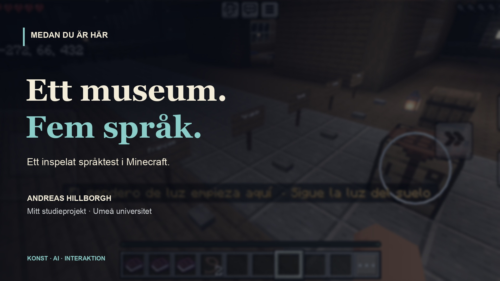

# Medan du är här

**Ett museum där besökarens närvaro blir en del av verket**

En rumslig installation i Minecraft med åtta sammanhängande zoner. Poesi, musik, bild och programmerat ljus möter besökaren genom personliga, flerspråkiga förlopp.

## Ett museum. Fem språk.

[](https://swedishgold.github.io/portfolio/#museum-film)

[Spela filmen / Watch the demo](https://swedishgold.github.io/portfolio/#museum-film) · [Öppna MP4](https://swedishgold.github.io/portfolio/assets/museum-language-demo.mp4)

Verklig mobilinspelning från 30 oktober 2026: svenska, engelska, spanska, brasiliansk portugisiska och franska. Mitt pågående studieprojekt vid Umeå universitet. Guiden använder förproducerat tal och programmerade flöden. Filmen visar språkbyten, inte en fullständig museivandring eller språkgranskning.

A real mobile recording of the guide in five languages, from my ongoing study project at Umeå University. It shows language switching with authored speech and programmed sequences, not free-form LLM conversation or a complete museum tour. Press play to start; nothing plays automatically.

## Behov

Hur går man från en konstnärlig idé om närvaro, tid och relationer till en sammanhängande upplevelse som fungerar för olika besökare och klienter?

## Lösning

En personlig välkomstvärd, språkval och tre språkanknutna böcker leder in i upplevelsen. Fem producerade språkeditioner kombineras med närvaro- och tidsstyrd logik. Java/Paper och Geyser/Floodgate förbinder dator- och mobilklienter. Innehållet är förproducerat och kodstyrt, inte fri LLM-konversation.

## Min insats

Initiativtagare, kreativ projektledare och kurator. Jag har styrt riktning, promptning och urval samt provat upplevelsen. Efter mobilprov föreslog jag exempelvis att flytta finalens ljusträd in i rummets cirkel och anpassa skalan. Hermes omsatte riktningen i förslag, kod, medier och tekniska kontroller.

## Verifiering

Dokumenterat användarprov 2026-10-22 omfattade dator, mobil och två samtidiga personliga guider. Publik serverdrift dokumenterades 25–26 oktober. För denna portfolio har projektkällor granskats; inga nya server- eller klientprov har körts.

## Avgränsning

Dagens tillgänglighet och aktuell mobilversionskompatibilitet är inte verifierade här. Två besökare är inte ett kapacitetstest. Detta är ett separat projekt, inte den äldre Minecraft/MCP-prototypen. Konceptflödet nedan är inte en skärmbild av museet.

## Förenklat flöde

```text
Språkval → Personlig välkomstvärd → Rum / närvaro → Poesi, ljud och ljus
```

**Teknik:** Minecraft / Paper, Java, Python, Geyser / Floodgate, Obsidian.

**Status:** Pågående interaktivt konstprojekt.

## English

While You Are Here is an interactive Minecraft art installation: eight connected zones, five authored language editions and personal visitor sequences. I lead the concept, curation and iteration; AI assists implementation. The runtime uses programmed logic, not free-form LLM conversation.


[Tillbaka till urvalet](../README.md)
